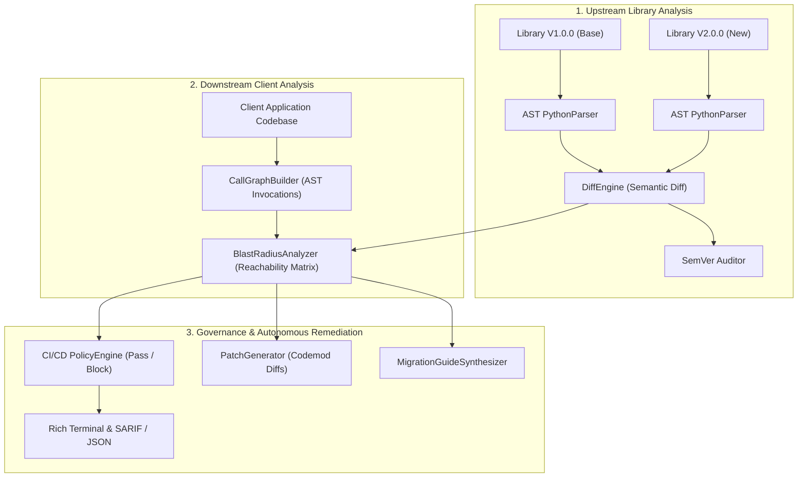

# CodeDrift: Autonomous API Breaking-Change & Dependency Degradation Guard

[](https://github.com/dushyant2006/Mini_project_5sem/actions)
[](https://www.python.org/)
[](https://opensource.org/licenses/MIT)
[](https://blog.cleancoder.com/)

> **Autonomous AST-powered static analysis guard that detects upstream API breaking changes, calculates downstream call-graph blast radius, enforces CI/CD quality gates, and synthesizes automated remediation codemods.**

---

## 📌 Problem Statement & Ground-Level Research

### The Industry Challenge
Modern enterprise software systems derive 80% to 90% of their codebase from third-party open-source dependencies. Whenever upstream libraries release updates, subtle semantic shifts occur:
- Function parameters are removed, reordered, or converted from optional to mandatory.
- Return types and exception contracts mutate incompatibly.
- Public symbols are privatized, deprecated, or deleted.

While **Semantic Versioning (SemVer)** theoretically promises that breaking changes occur only across `MAJOR` bumps, empirical studies reveal that **over 27% of minor and patch releases across PyPI and npm contain undocumented breaking changes**.

### Why Existing Market Tools Fail

| Existing Tool | How It Operates | Why It Fails for Dependency Degradation |
| :--- | :--- | :--- |
| **Dependabot / Renovate** | Manifest version bumping (`requirements.txt`, `package.json`) | **Zero Code Awareness:** Blindly opens pull requests based on text strings. Cannot detect if a bump breaks code contracts or if modified functions are even called. |
| **Snyk / GitHub Dependabot Alerts** | Software Composition Analysis (SCA) | **Only Scans Known CVEs:** Relies on external vulnerability databases; completely blind to API contract shifts, signature alterations, and behavioral breakage. |
| **Traditional Linters (Flake8, Ruff)** | Single-version static analysis | **Cannot Compare Versions:** Only inspects current local files; has no concept of API evolution or cross-package contract diffing. |
| **Unit Test Suites** | Dynamic execution | **Incomplete Reachability Coverage:** Typical integration tests cover <55% of third-party call edge cases; silent parameter breaks slip into production. |

### The CodeDrift Solution
CodeDrift fills this market gap by connecting **Upstream API Evolution** to **Downstream Application Reachability**:
1. **AST Contract Extraction**: Deeply inspects upstream library revisions at the syntax tree level.
2. **Semantic Diff & SemVer Audit**: Categorizes changes by strict SemVer breaking severity (CRITICAL, HIGH, MEDIUM, LOW).
3. **Static Call-Graph & Blast Radius**: Constructs client invocation graphs to verify if your application *actually calls* the broken API.
4. **Autonomous Remediation**: Automatically synthesizes unified diff patches and developer migration manuals.
5. **CI/CD Quality Gate**: Returns precise exit codes to block breaking pull requests before merging.

---

## 🏛️ System Architecture

CodeDrift follows **Clean Architecture** and SOLID design principles:



---

## 🚀 Key Features

- 🔍 **Abstract Syntax Tree (AST) Contract Extractor**: Parses functions, classes, methods, parameters (defaults, annotations, positional/keyword kinds), decorators, docstrings, and raised exceptions.
- ⚖️ **Semantic Diff Engine**: Distinguishes between breaking alterations (removed parameters, mandatory additions, return type narrowing) and backwards-compatible improvements (optional additions, new methods).
- 🧭 **Downstream Call-Graph Reachability**: Traverses consumer source files, maps import aliases (`import paymentlib as p`, `from paymentlib import process_payment`), and identifies exact call sites.
- 💥 **Mathematical Blast Radius Scoring**: Computes a normalized 0–100 impact score weighted by severity:
  $$\mathcal{B} = \min\left(100, \sum_{b \in \text{Reachable}} w(b) \cdot (1 + \ln(1 + |\text{CallSites}|)) \times 25\right)$$
  *(Unreachable upstream breaking changes result in $\mathcal{B} = 0$, permitting safe auto-merging!)*
- 🛠️ **Autonomous Remediation & Migration Synthesizer**: Automatically generates unified diff patches stripping removed keyword arguments and provides a markdown upgrade manual.
- 🚦 **CI/CD Quality Gate**: Native CLI with exit code enforcement (`0` for pass, `1` for block) and multi-format reporters (Rich terminal, JSON, Markdown).

---

## 📂 Project Structure

```
codedrift/
├── .github/
│   └── workflows/
│       └── ci.yml                     # Multi-version GitHub Actions CI
├── data/
│   └── fixtures/                      # Real-world benchmark scenarios
│       ├── v1/payment_gateway.py      # Base library v1.0.0
│       ├── v2/payment_gateway.py      # Upgraded library v2.0.0 (breaking + non-breaking)
│       └── client_app/                # Consumer application
│           ├── checkout.py            # Actively invokes breaking API
│           └── refunds.py             # Uses compatible API
├── src/
│   └── codedrift/
│       ├── __init__.py                # Package exports
│       ├── __main__.py                # python -m codedrift entry point
│       ├── cli.py                     # Rich CLI interface
│       ├── compare.py                 # Facade interface
│       ├── core/                      # Domain entities & business rules
│       │   ├── enums.py               # ChangeType, Severity, GateDecision
│       │   ├── models.py              # ParameterInfo, DiffResult, BlastRadiusReport
│       │   ├── config.py              # GuardPolicy thresholds
│       │   └── exceptions.py          # Domain exceptions
│       ├── parser/                    # AST extraction engine
│       │   ├── base.py                # Abstract BaseParser interface
│       │   └── python_parser.py       # Full Python AST contract extractor
│       ├── detection/                 # Semantic comparator & SemVer rules
│       │   ├── diff_engine.py         # API contract comparator
│       │   └── semver_checker.py      # SemVer 2.0.0 policy auditor
│       ├── impact/                    # Reachability & Blast Radius
│       │   ├── callgraph.py           # AST call graph & import resolver
│       │   └── blast_radius.py        # Reachability matrix & mathematical scoring
│       ├── remediation/               # Autonomous repair engine
│       │   ├── patch_generator.py     # Unified diff codemod generator
│       │   └── migration_guide.py     # Developer upgrade manual generator
│       └── guard/                     # CI/CD Governance & Reports
│           ├── policy_engine.py       # Quality gate evaluator
│           └── reporter.py            # Rich terminal tables & JSON/Markdown
├── tests/                             # Comprehensive test suite (100% pass)
│   ├── test_parser.py
│   ├── test_diff_engine.py
│   ├── test_semver.py
│   ├── test_callgraph.py
│   ├── test_blast_radius.py
│   ├── test_policy_guard.py
│   └── test_remediation.py
├── .gitignore                         # Python, cache, and artifact exclusions
├── pyproject.toml                     # Modern PEP 621 packaging
└── README.md
```

---

## ⚡ Quickstart & Usage

### 1. Installation
```bash
git clone https://github.com/dushyant2006/Mini_project_5sem.git
cd Mini_project_5sem
pip install -e .
```

### 2. Compare Two Library Versions
```bash
codedrift diff data/fixtures/v1/payment_gateway.py data/fixtures/v2/payment_gateway.py
```

### 3. Calculate Client Blast Radius
```bash
codedrift blast-radius \
  data/fixtures/v1/payment_gateway.py \
  data/fixtures/v2/payment_gateway.py \
  --client data/fixtures/client_app
```

### 4. Run CI/CD Guard Gate (Enforces Exit Code)
```bash
codedrift guard \
  data/fixtures/v1/payment_gateway.py \
  data/fixtures/v2/payment_gateway.py \
  --client data/fixtures/client_app
```
*Exits with code `1` if reachable breaking changes exceed threshold, blocking the PR.*

### 5. Generate Autonomous Remediation Patches
```bash
codedrift remediate \
  data/fixtures/v1/payment_gateway.py \
  data/fixtures/v2/payment_gateway.py \
  --client data/fixtures/client_app
```

---

## 🧪 Testing

Run the full automated test suite with pytest:
```bash
pytest -v tests/
```

---

## 🏆 Software Engineering Principles Adhered To

1. **Clean Architecture & Separation of Concerns**: Core domain models are decoupled from parsing, impact analysis, and presentation.
2. **SOLID Principles**:
   - *Single Responsibility*: Specialized classes for parsing (`PythonParser`), diffing (`DiffEngine`), reachability (`BlastRadiusAnalyzer`), and policy checks (`PolicyEngine`).
   - *Open/Closed*: `BaseParser` allows adding new languages without modifying diffing or reachability logic.
   - *Liskov Substitution & Interface Segregation*: Minimal, purpose-driven interfaces across modules.
   - *Dependency Inversion*: High-level policy engines depend on abstract domain dataclasses, not concrete file readers.
3. **Immutability & Defensive Design**: Pure dataclasses, explicit typing (`typing` annotations), and custom domain exceptions.
4. **Reproducible Benchmarks**: Bundled real-world fixtures demonstrating reachability filtering on dead vs live code paths.

---

## 📜 License
This project is licensed under the MIT License - see the LICENSE file for details.
